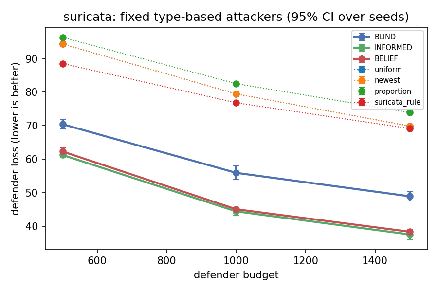
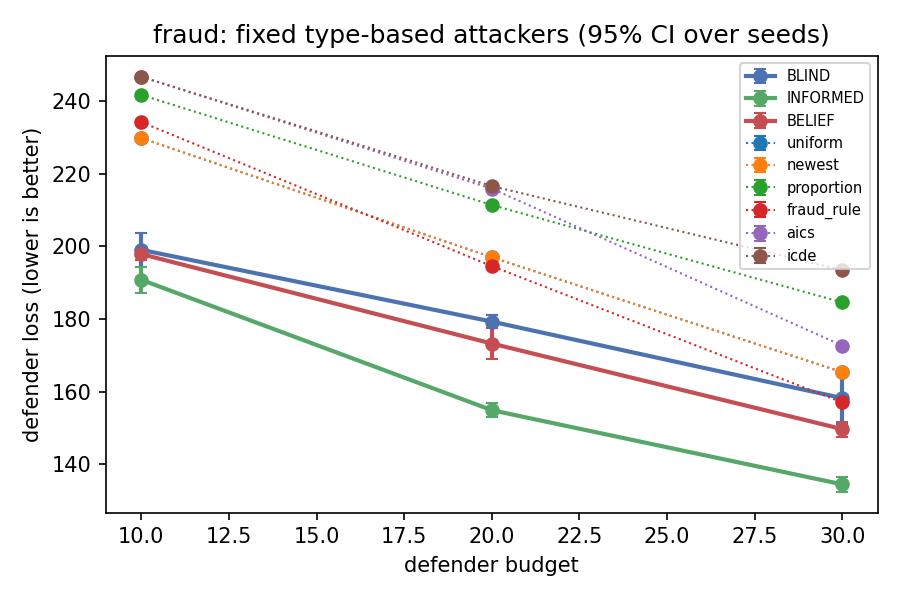
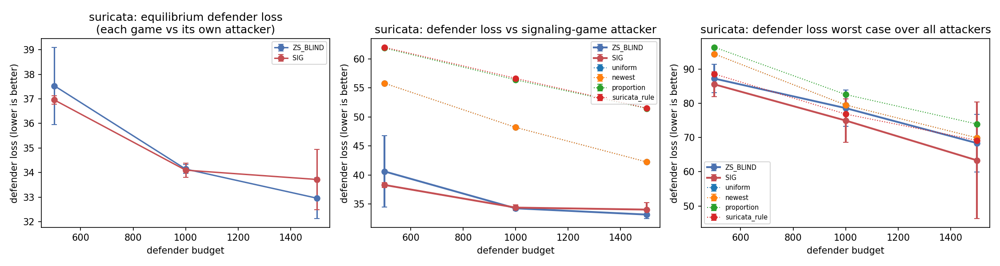
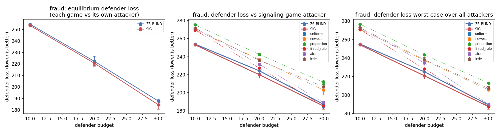
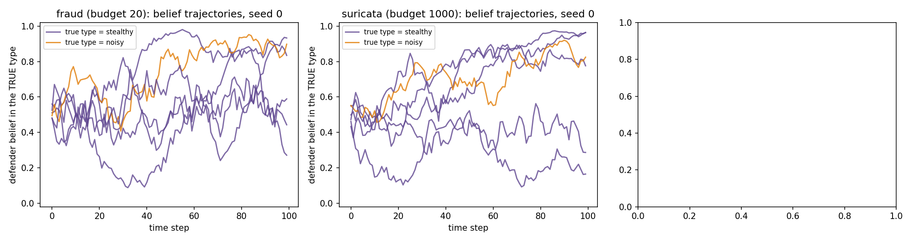
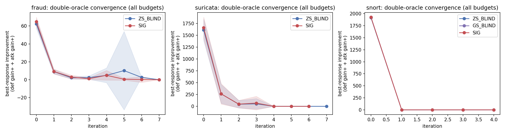
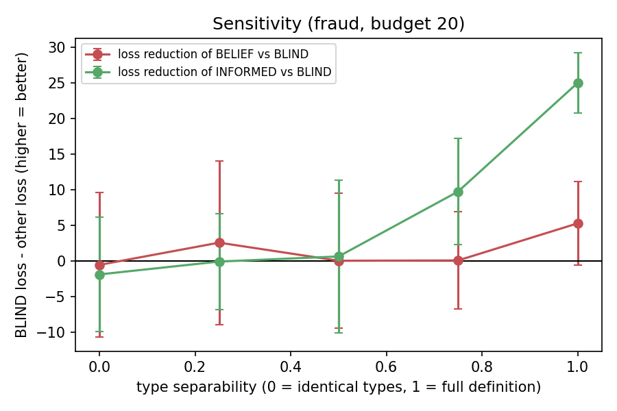

# Alert prioritisation as a SIGNALING GAME

This branch (`signaling`) extends the general-sum alert-prioritisation code (Tong et al. 2019
"AlertPrioritization", SAC-AP) into a **signaling game**. In it, the attacker has a hidden
*type* and the defender has to infer that type from the alerts. Everything in the original
code still runs unchanged. The new code is in separate files (see `SIGNALING_NOTES.md`).

---

## 1. The model in plain English

**The setting.** An intrusion-detection system raises thousands of alerts per time step,
mostly false. A security team (the *defender*) can only investigate a limited number per
step (budget B). An *attacker* mounts attacks that trigger some of these alerts. An attack
that is not investigated causes a loss.

**Players and what they know.**

| | Attacker | Defender |
|---|---|---|
| Knows its own type? | yes | **no** |
| Sees | the full system state (alerts, which attacks are live, which alerts are real) and its type | only the **alert counts per alert type** (the *signal*) |
| Chooses each step | probability of mounting each attack (within attack budget D) | how many alerts of each type to investigate (within budget B) |

**Types (who the attacker is).** At the start of every episode, *Nature* secretly draws
the attacker's type from a prior (default 50% / 50%; up to 3 types are supported):

* **Noisy / flooding.** Each attack raises *twice as many* alerts as in the original data,
  and half of them are spread across *all* alert types. Loud, and it acts as a distraction.
* **Stealthy.** Each attack raises *half as many* alerts, all of them in the alert type that
  already has the *most false alarms*. It hides in the noise.

Both types have exactly the same attack actions, losses, gains and costs. Only *which and
how many alerts* their attacks trigger differs. All type parameters are in the `[signaling]`
section of `src/signaling_toy.conf` / `src/signaling_full.conf`.

**Belief.** After every step the defender updates its belief
b = P(type | all alert counts seen so far) with **Bayes' rule**:

    b_new(type) ∝ b_old(type) × P(alert counts this step | type)

The likelihood P(alert counts | type) is computed *exactly* from the model's own rules:
false alerts are Poisson, and each attack adds alerts with the type's trigger probabilities.
That means summing over every combination of attacks that could be live. It is computed in
log space so the 10-million-alert snort counts don't overflow. Observing alerts is free;
only investigating costs budget.

**Payoffs.** Unchanged from the existing code (`Model.next_state`). The defender loses
L_a for every step an attack a stays undetected. The attacker gets gain_a minus the cost
of the attacks it mounts. In **zero-sum** mode gain = loss. In **general-sum** mode the
gains from `test.py` are used (only snort has separate gains; for suricata and fraud the
two modes coincide).

**Policies (learned by deep RL).**
* Defender network input: alert counts + belief (BELIEF/SIG), alert counts only (BLIND),
  or alert counts + the *true* type (INFORMED, a cheating upper bound).
* Attacker network input: system state + one-hot of its own type. It can therefore behave
  differently per type, for example imitate the other type's alert signature ("pooling").

**Equilibrium concept and how it is approximated.** The right solution concept for a
signaling game is a *perfect Bayesian equilibrium* (PBE). In a PBE, each type's strategy is a
best response, the defender's strategy is a best response given its beliefs, and the beliefs
follow Bayes' rule from the attacker's strategy wherever possible. We approximate it with the
existing **double-oracle** loop:

1. Keep a pool of attacker policies (type-conditioned) and defender policies (belief-conditioned).
2. Compute a mixed Nash equilibrium of the small matrix game between the pools (nashpy,
   same `defender_max` / `welfare_max` options as before).
3. Train a new attacker best response and a new defender best response with RL against the
   current mixture and add them to the pools. The defender's Bayes filter uses the attack rates
   of the current equilibrium attacker mixture (its "conjecture").
4. Repeat until neither new best response improves on the equilibrium, or a maximum number of iterations.

**This is an approximation, not a proof of a PBE.** (i) RL best responses are approximate.
(ii) The double oracle is stopped after a few iterations. (iii) The defender's Bayes filter
uses each type's *average* attack rate, because the attacker reacts to state the defender
cannot see. (iv) Off-path beliefs follow a fixed convention (keep the previous belief) with
a small "trembling hand" (attack rates conjectured in [0.001, 0.999]). We check (iii) and
(iv) empirically: the belief diagnostics compare the defender's belief with exact Bayes on
the attacker's realised behaviour, and report calibration and off-path frequencies.

---

## 2. Experimental conditions

All conditions use the same datasets, budgets, seeds, evaluation episodes, network sizes and
training length (`src/signaling_full.conf`).

| Name | What it is |
|---|---|
| **BLIND** (a) | Existing general-sum style defender: sees alert counts only. |
| **INFORMED** (b) | Defender is told the true type (cheating upper bound). |
| **BELIEF** (c) | Defender sees alert counts + Bayes belief; attackers are fixed. |
| **ZS_BLIND** | Double oracle, **zero-sum** payoffs, blind defender: the SAC-AP zero-sum approach re-run in the two-type world. |
| **GS_BLIND** | Double oracle, general-sum payoffs, blind defender (snort only; identical to ZS_BLIND elsewhere). |
| **SIG** (d) | Double oracle, full **signaling game**: type-conditioned learning attacker vs belief defender. |
| Baselines | uniform, newest, proportion, Snort/Suricata priority rules, fraud rule, aics, icde (where `test.py` supports them). |

In (a)–(c) each type plays the existing uniform attacker, so the types differ only in their
alert signature.

The **headline comparison** is the *cross-evaluation*: the final defender of each game is
played against the *same* attackers (each game's final attacker and the fixed attacker),
on identical episodes. Comparing the equilibrium values of different games directly is not
fair, because a zero-sum attacker tries harder to hurt the defender than a general-sum one.

---

## 3. How to reproduce

```bash
git clone https://github.com/deek-sha545/Signalling_game_IDS.git ids-signaling
cd ids-signaling && git checkout signaling
~/.pyenv/versions/3.7.17/bin/python -m venv venv
venv/bin/pip install tensorflow==1.13.1 "protobuf<3.21" numpy==1.21.6 scipy==1.7.3 nashpy==0.0.17
venv/bin/pip freeze > /tmp/c.txt && venv/bin/pip install matplotlib==3.5.3 -c /tmp/c.txt

./run_signaling.sh toy      # a few minutes: unit tests + whole pipeline at tiny scale
./run_signaling.sh full     # the paper results (about 12-15 h on 8 cores)
```

To run it in the background with a log, as was done for the results below:

```bash
nohup ./run_signaling.sh full > logs/full_run.log 2>&1 & disown
```

* Unit tests only: `cd src && IDS_CONFIG=signaling_toy.conf ../venv/bin/python -m unittest test_signaling_belief -v`
* Choose the RL algorithm: `oracle_algo = ddpg | sac | td3` in the config.
* The original (non-signaling) pipeline is unchanged: `cd src && python -u double_oracle.py snort 1000 125 1`
  (reads `project.conf`; `IDS_CONFIG=<file>` selects another config).
* Raw per-job outputs: `runs/full_v2/` (not in git) (JSON, logs, belief trajectories).
  Tables and figures: `results/full_v2/` (`RESULTS.md` has every table).

---

## 4. Results

> **Status: INTERIM results, 2026-11-01 20:28 IST, 74 of 90 main jobs finished** (the FULL run is still in progress; the sensitivity study is complete). Seed counts per row are in column n; the final version will have 10 seeds per row.

Loss = expected discounted defender loss per episode (lower is better). Mean ± std over independent seeds (n). Full tables with 95% CIs: [`results/full_v2/RESULTS.md`](results/full_v2/RESULTS.md); raw CSVs and figures are in `results/full_v2/`.

### 4.1 Does the belief help against FIXED type-based attackers? (conditions a, b, c)

| dataset | B | n | BLIND | BELIEF | INFORMED (upper bound) | best rule baseline | BELIEF−BLIND | paired t p | Wilcoxon p |
|---|---|---|---|---|---|---|---|---|---|
| suricata | 500 | 8 | 70.4 ± 1.8 | 62.3 ± 1.2 | 61.3 ± 1.0 | 88.5 (suricata_rule) | -8.1 | <0.001 | 0.008 |
| suricata | 1000 | 7 | 56.0 ± 2.2 | 45.1 ± 0.5 | 44.5 ± 1.3 | 76.8 (suricata_rule) | -10.9 | <0.001 | 0.016 |
| suricata | 1500 | 7 | 49.0 ± 1.5 | 38.4 ± 0.6 | 37.6 ± 1.6 | 69.2 (suricata_rule) | -10.6 | <0.001 | 0.016 |
| fraud | 10 | 9 | 199.0 ± 6.1 | 197.8 ± 2.0 | 190.8 ± 4.7 | 229.8 (uniform) | -1.2 | 0.637 | 0.612 |
| fraud | 20 | 9 | 179.3 ± 2.4 | 173.2 ± 5.6 | 154.9 ± 2.4 | 194.5 (fraud_rule) | -6.0 | 0.007 | 0.020 |
| fraud | 30 | 8 | 158.2 ± 8.5 | 149.7 ± 2.4 | 134.5 ± 2.4 | 157.0 (fraud_rule) | -8.5 | 0.008 | 0.008 |
| snort | 500 | 9 | 33.0 ± 1.6 | 32.4 ± 0.3 | 32.4 ± 0.0 | 32.3 (uniform) | -0.6 | 0.322 | 0.652 |
| snort | 1000 | 9 | 30.1 ± 2.9 | 28.9 ± 0.0 | 29.4 ± 1.2 | 28.9 (uniform) | -1.2 | 0.249 | 0.063 |
| snort | 1500 | 8 | 26.8 ± 0.7 | 26.6 ± 0.0 | 26.6 ± 0.0 | 26.6 (uniform) | -0.2 | 0.351 | 0.317 |

### 4.2 Signaling game vs zero-sum game (double oracle, cross-evaluation)

Each game's final defender is played against the same attackers on identical episodes. "worst" = the defender's worst loss over the three attackers. Negative difference = the signaling defender loses less.

| dataset | B | n | attacker | ZS_BLIND defender | SIG defender | SIG − ZS | % | paired t p | Wilcoxon p |
|---|---|---|---|---|---|---|---|---|---|
| suricata | 500 | 8 | SIG_attacker | 40.6 | 38.3 | -2.33 | -5.7% | 0.399 | 0.742 |
| suricata | 500 | 8 | ZS_BLIND_attacker | 38.6 | 41.0 | +2.38 | +6.2% | 0.301 | 0.547 |
| suricata | 500 | 8 | fixed_uniform | 87.2 | 85.5 | -1.69 | -1.9% | 0.521 | 0.461 |
| suricata | 500 | 8 | worst | – | – | -1.69 | -1.9% | 0.521 | 0.461 |
| suricata | 1000 | 7 | SIG_attacker | 34.3 | 34.4 | +0.13 | +0.4% | 0.604 | 0.938 |
| suricata | 1000 | 7 | ZS_BLIND_attacker | 34.3 | 34.4 | +0.13 | +0.4% | 0.604 | 0.938 |
| suricata | 1000 | 7 | fixed_uniform | 78.6 | 75.0 | -3.63 | -4.6% | 0.387 | 0.469 |
| suricata | 1000 | 7 | worst | – | – | -3.63 | -4.6% | 0.387 | 0.469 |
| suricata | 1500 | 7 | SIG_attacker | 33.2 | 34.0 | +0.86 | +2.6% | 0.245 | 0.297 |
| suricata | 1500 | 7 | ZS_BLIND_attacker | 33.2 | 34.0 | +0.86 | +2.6% | 0.245 | 0.297 |
| suricata | 1500 | 7 | fixed_uniform | 68.4 | 63.3 | -5.03 | -7.4% | 0.549 | 0.578 |
| suricata | 1500 | 7 | worst | – | – | -5.03 | -7.4% | 0.549 | 0.578 |
| fraud | 10 | 9 | SIG_attacker | 254.0 | 253.1 | -0.82 | -0.3% | 0.124 | 0.161 |
| fraud | 10 | 9 | ZS_BLIND_attacker | 255.1 | 254.1 | -0.91 | -0.4% | 0.097 | 0.069 |
| fraud | 10 | 9 | fixed_uniform | 197.1 | 198.5 | +1.35 | +0.7% | 0.351 | 0.674 |
| fraud | 10 | 9 | worst | – | – | -0.86 | -0.3% | 0.113 | 0.093 |
| fraud | 20 | 9 | SIG_attacker | 224.3 | 220.0 | -4.30 | -1.9% | 0.010 | 0.027 |
| fraud | 20 | 9 | ZS_BLIND_attacker | 222.8 | 217.9 | -4.87 | -2.2% | 0.010 | 0.020 |
| fraud | 20 | 9 | fixed_uniform | 179.0 | 174.7 | -4.26 | -2.4% | 0.123 | 0.164 |
| fraud | 20 | 9 | worst | – | – | -4.35 | -1.9% | 0.009 | 0.020 |
| fraud | 30 | 8 | SIG_attacker | 187.2 | 185.3 | -1.98 | -1.1% | 0.182 | 0.250 |
| fraud | 30 | 8 | ZS_BLIND_attacker | 188.4 | 186.9 | -1.48 | -0.8% | 0.259 | 0.312 |
| fraud | 30 | 8 | fixed_uniform | 156.4 | 157.2 | +0.77 | +0.5% | 0.722 | 0.844 |
| fraud | 30 | 8 | worst | – | – | -1.79 | -0.9% | 0.189 | 0.250 |
| snort | 500 | 9 | SIG_attacker | 8.2 | 8.2 | +0.00 | +0.0% | nan | nan |
| snort | 500 | 9 | ZS_BLIND_attacker | 8.2 | 8.2 | +0.00 | +0.0% | nan | nan |
| snort | 500 | 9 | fixed_uniform | 32.3 | 32.3 | +0.00 | +0.0% | nan | nan |
| snort | 500 | 9 | worst | – | – | +0.00 | +0.0% | nan | nan |
| snort | 1000 | 9 | SIG_attacker | 5.3 | 5.3 | +0.00 | +0.0% | nan | nan |
| snort | 1000 | 9 | ZS_BLIND_attacker | 5.3 | 5.3 | +0.00 | +0.0% | nan | nan |
| snort | 1000 | 9 | fixed_uniform | 28.9 | 28.9 | +0.00 | +0.0% | nan | nan |
| snort | 1000 | 9 | worst | – | – | +0.00 | +0.0% | nan | nan |
| snort | 1500 | 8 | SIG_attacker | 3.4 | 3.4 | +0.00 | +0.0% | nan | nan |
| snort | 1500 | 8 | ZS_BLIND_attacker | 3.4 | 3.4 | +0.00 | +0.0% | nan | nan |
| snort | 1500 | 8 | fixed_uniform | 26.6 | 26.6 | +0.00 | +0.0% | nan | nan |
| snort | 1500 | 8 | worst | – | – | +0.00 | +0.0% | nan | nan |

### 4.3 Equilibrium values (expected defender loss at the final restricted equilibrium)

| dataset | B | game | n | eq. defender loss | std | mean DO iterations |
|---|---|---|---|---|---|---|
| fraud | 10 | ZS_BLIND | 9 | 254.6 | 0.7 | 3.9 |
| fraud | 10 | SIG | 9 | 253.5 | 1.4 | 4.3 |
| fraud | 20 | ZS_BLIND | 9 | 222.3 | 5.8 | 3.7 |
| fraud | 20 | SIG | 9 | 220.6 | 2.8 | 3.7 |
| fraud | 30 | ZS_BLIND | 8 | 187.5 | 1.9 | 3.8 |
| fraud | 30 | SIG | 8 | 184.3 | 4.6 | 4.4 |
| suricata | 500 | ZS_BLIND | 8 | 37.5 | 1.9 | 4.8 |
| suricata | 500 | SIG | 8 | 37.0 | 0.2 | 4.8 |
| suricata | 1000 | ZS_BLIND | 7 | 34.1 | 0.2 | 4.0 |
| suricata | 1000 | SIG | 7 | 34.1 | 0.3 | 4.7 |
| suricata | 1500 | ZS_BLIND | 7 | 33.0 | 0.9 | 5.6 |
| suricata | 1500 | SIG | 7 | 33.7 | 1.3 | 4.3 |
| snort | 500 | ZS_BLIND | 9 | 8.1 | 0.0 | 3.1 |
| snort | 500 | GS_BLIND | 9 | 8.1 | 0.0 | 3.1 |
| snort | 500 | SIG | 9 | 8.1 | 0.0 | 3.1 |
| snort | 1000 | ZS_BLIND | 9 | 4.8 | 0.0 | 3.1 |
| snort | 1000 | GS_BLIND | 9 | 4.8 | 0.0 | 3.3 |
| snort | 1000 | SIG | 9 | 4.8 | 0.0 | 3.3 |
| snort | 1500 | ZS_BLIND | 8 | 3.1 | 0.0 | 3.1 |
| snort | 1500 | GS_BLIND | 8 | 3.1 | 0.0 | 3.0 |
| snort | 1500 | SIG | 8 | 3.1 | 0.0 | 3.0 |

Equilibrium values of different games are not directly comparable (different attacker objectives); 4.2 is the fair comparison. For suricata and fraud the zero-sum and general-sum payoffs coincide in the original data (only snort sets separate gains), so GS_BLIND is run only on snort.

### 4.4 Sensitivity: how distinguishable the types are vs the value of the belief (fraud, B = 20, fixed attackers)

separability 0 = both types identical, 1 = the default types.

| separability | comparison | n | mean loss reduction | std | paired t p |
|---|---|---|---|---|---|
| 0 | BLIND - BELIEF | 5 | -0.5 | 8.1 | 0.897 |
| 0.25 | BLIND - BELIEF | 5 | 2.6 | 9.3 | 0.561 |
| 0.5 | BLIND - BELIEF | 5 | 0.1 | 7.6 | 0.983 |
| 0.75 | BLIND - BELIEF | 5 | 0.1 | 5.5 | 0.962 |
| 1 | BLIND - BELIEF | 5 | 5.3 | 4.7 | 0.066 |
| 0 | BLIND - INFORMED | 5 | -1.8 | 6.4 | 0.558 |
| 0.25 | BLIND - INFORMED | 5 | -0.0 | 5.4 | 0.988 |
| 0.5 | BLIND - INFORMED | 5 | 0.7 | 8.6 | 0.869 |
| 0.75 | BLIND - INFORMED | 5 | 9.8 | 6.0 | 0.022 |
| 1 | BLIND - INFORMED | 5 | 25.0 | 3.4 | <0.001 |

### Figures









### 4.5 What the numbers say (interim reading; will be updated with all 10 seeds)

1. **Against fixed type-based attackers the Bayes belief clearly helps on suricata.** BELIEF is far
   below BLIND at every budget and close to the cheating INFORMED defender (table 4.1). On fraud the gain is
   smaller (significant at B = 20, 30 but not at B = 10), and INFORMED is far better than BELIEF there:
   the fraud alerts reveal the type only slowly (mean belief on the true type 0.51 / 0.56 / 0.67 after
   steps 1 / 5 / 20, versus 0.79 / 0.99 / 1.00 on suricata).
2. **At equilibrium, against an adaptive learned attacker, the advantage largely disappears.** On suricata
   the signaling defender and the zero-sum defender are tied within noise against the learned attackers;
   the signaling defender is better against the fixed attacker, but not significantly. On fraud the
   signaling defender has a lower loss at every budget, but only by about 0.3-2%. The difference is
   significant at B = 20 (p about 0.01-0.02 before correction for multiple comparisons) and not at B = 10
   or 30. **Overall this is a weak / partly inconclusive advantage for the signaling game, reported as such.**
3. **Snort does not discriminate.** All defenders, games and baselines give the same loss. Alert type 2 has
   no false alerts and the existing budget-feasibility rule sends the whole budget to the alert types that
   have alerts, so the simple heuristics are already optimal (see `SIGNALING_NOTES.md`, decision 29).
4. **Sensitivity (4.4):** the more distinguishable the types, the more INFORMED gains; BELIEF gains little
   on fraud at any separability, consistent with point 1.
5. **Against rule-based baselines:** in the worst case over attackers, the signaling defender beats every rule baseline by about 20-39% on suricata. On fraud it beats them by 3-12%, except that the fraud-specific rule (and aics) ties with it at B = 30 (`results/full_v2/cross_evaluation_tests.csv`).

**Limitations.** The double oracle with RL best responses approximates a perfect Bayesian equilibrium; it
does not prove one (section 1). Oracles are DDPG: the existing SAC implementation collapsed to a uniform
split in this setting (`SIGNALING_NOTES.md`). Training lengths are reduced (200 episodes per oracle,
up to 8 DO iterations) to fit the compute budget, identically for all conditions.
